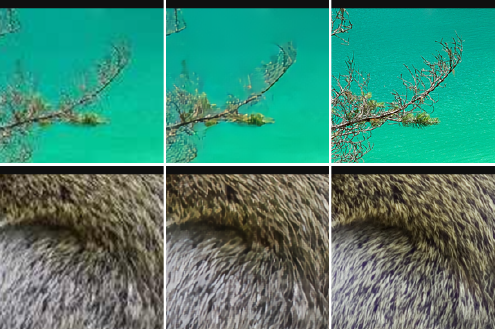

# 传输退化图像复原

把微信等社交软件传过一遍、压糊了的图片，还原成清晰的样子。

[](https://mj-jia.github.io/python1/)

纯浏览器推理，图片不上传服务器，点开就能用。



左：原图　中：传输退化后　右：复原结果

---

## 这是什么问题

「微信发的图变糊」不是单一原因，而是四个环节叠加：

| 环节 | 发生了什么 | 留下什么 |
|---|---|---|
| ① 降分辨率 | 长边缩到 1080 档 | 高频整体丢失 |
| ② 编码压缩 | 8×8 DCT + 量化 + 色度 4:2:0 | 块效应、色带、蚊式噪声 |
| ③ 二次转码 | 服务端再压一次 | 伪影叠加 |
| ④ 显示端放大 | 插值回原尺寸 | **糊的主因**，边缘发虚 |

Real-ESRGAN 这类通用模型假设的是「随机均匀退化」，和真实链路的「内容依赖退化」不是一回事：

| 维度 | Real-ESRGAN | 真实传输链路 |
|---|---|---|
| 参数来源 | 随机采样 | 由码率预算决定，只有离散几档 |
| 空间分布 | 全局均匀 | **内容依赖**：平坦区与纹理区差异显著 |
| 损伤形态 | 只有平滑退化 | 还有**周期性块状伪影** |
| 优化目标 | 全图统一偏向感知 | 平坦区保真、纹理区观感，**两者冲突** |

## 方法

主干不动（Real-ESRGAN 的 SRVGGNetCompact，1.15M 参数），只改**退化建模**和**损失设计**两侧。

### 创新一：内容依赖的非均匀退化建模（数据侧）

不用 libjpeg（它的 quality 是图像级参数，DQT 表全局唯一，做不到逐块量化），用纯 numpy 走一遍 DCT：

```
8×8 分块 → 算每块局部纹理能量 E → 按 E 分配量化步长 → DCT → 量化 → IDCT
```

方向是 **E 大（纹理）→ 质量高 → 量化步长小**；E 小（平坦）→ 质量低 → 步长大。

实测：逐块 quality 与局部能量的相关系数 **r = 0.960**，平坦/纹理块效应比 1.35（均匀分配只有 1.05）。

### 创新二：压缩块效应感知损失（损失侧）

```
blockiness(x) = 块边界梯度均值 / (块内梯度均值 + 0.5/255)
L_block = relu(blockiness(pred) − blockiness(GT)) / clamp(blockiness(GT), 0.3)
```

单向惩罚，只在「输出比原图更像块状」时罚，避免误伤正常边缘。

### 创新三：空间自适应混合损失（损失侧）

```
w = τ / (局部梯度能量 + τ)        # 1 = 平坦，0 = 纹理
L = mean(w ⊙ L1) + λ · mean((1−w) ⊙ LPIPS_spatial)
```

平坦区偏 L1 保数值，纹理区偏 LPIPS 保观感。

### 三个创新是一条链，不是三个亮点

```
创新一（数据）造出「带周期性块效应的非均匀退化」
      ↓  提供针对性
创新二（损失）专门压制其中最难的「8×8 规则方块」
      ↓  清掉方块后
创新三（损失）才能按区域决定「保数值还是保观感」
```

## 结果

DIV2K 验证集后 80 张，512×512 center crop，固定退化种子：

| 组 | PSNR↑ | SSIM↑ | LPIPS↓ | 块效应↓ | 纹理梯度保留↑ |
|---|---|---|---|---|---|
| 退化图（不处理） | 26.258 | 0.7573 | 0.3678 | 1.077 | - |
| A 只用退化建模 | 27.280 | 0.7892 | 0.2818 | 0.981 | 0.494 |
| B +块效应损失 | 26.822 | 0.7744 | 0.3105 | **0.819** | 0.456 |
| C +空间加权 | 26.824 | 0.7724 | **0.1743** | 1.019 | **0.527** |
| D 完整（从零训） | 26.802 | 0.7711 | 0.1746 | 0.874 | 0.516 |
| **G 最终模型** | **27.389** | **0.7909** | **0.1644** | 0.890 | **0.538** |

**三组取舍是方法论证的核心**：

- **A 是保真极值**，PSNR 最高但 LPIPS 最差、块效应几乎没改善
- **B 是块效应极值**，压到 0.819 但纹理保留掉到 0.456——**为了压方块把细节一起抹了**
- **C 是感知极值**，LPIPS 最好但块效应反而升高
- **D 用空间加权把 B 误伤的纹理救回来**，这就是三点成链的直接证据

最终模型 G 在此基础上加载了官方 `realesr-general-x4v3` 的 32 层骨干（96/98 参数复用），微调 3000 iter，在 PSNR、SSIM、LPIPS、纹理保留四项上全面最优。

## 快速开始

### 网页版（推荐，零安装）

打开 https://mj-jia.github.io/python1/ ，拖图进去即可。

本地运行：

```bash
python serve.py 8000
# 打开 http://127.0.0.1:8000
```

### 命令行

```bash
pip install -r requirements.txt
python restore.py 我的糊图.jpg
# 输出到 outputs/
```

大图自动分块（tiling），不会爆显存。显存小可以调 `--tile 384`。

### 训练

```bash
bash scripts/run_ablation.sh 6000      # 四组消融
python src/train/train_sr.py --exp D --iters 6000
```

**数据集不随仓库分发。** 需自行获取 [DIV2K](https://data.vision.ee.ethz.ch/cvl/DIV2K/)，放进 `SR_Project/dataset/DIV2K_train_HR`（800 张）与 `DIV2K_valid_HR`（100 张），脚本按这个相对路径读取；划分与评测口径见 `docs/完整项目流程.md`。

## 代码结构

```
├── index.html              网页版界面与推理逻辑（含分块与羽化拼接）
├── ort/                    onnxruntime-web 运行时（第三方，约 36MB）
├── restore.onnx            网页用的模型（ONNX，4.5MB）
├── coi-serviceworker.min.js 注入 COOP/COEP，启用多线程推理
├── serve.py                本地带头静态服务器
├── restore.py              命令行复原（PyTorch，带 tiling 与羽化拼接）
├── src/
│   ├── degrade/            退化流水线（纯 numpy DCT）
│   ├── models/             SRVGGNetCompact
│   ├── train/              损失函数与训练脚本
│   ├── eval/               评测（全局 + 分区指标）
│   └── data/               数据集与在线退化
├── tools/                  核验、汇总、出图
├── scripts/                批量训练脚本
├── checkpoints/best.pth    训练好的模型权重（restore.py 默认加载）
├── experiments/            结果表与对比图
├── docs/                   完整流程、选题论证、网页版说明
├── requirements.txt        Python 依赖
├── LICENSE                 BSD-3-Clause
├── .gitignore              忽略 outputs/、数据集、训练产物
└── .gitattributes          第三方产物不计入语言统计
```

**根目录位置不能随便改**：`index.html`、`ort/`、`restore.onnx`、`coi-serviceworker.min.js` 必须待在仓库根目录——GitHub Pages 只能发布根目录或 `/docs`，挪进子目录会让首页 404。其余 Python 代码的摆放不受这个限制。

## 局限

**这是最重要的一节，请务必读完。**

- **2 倍下采样丢掉的细节无法真正重建。** 文件里只有约 25% 的频带信息，模型补的是「合理的猜测」，不是「原来的细节」。PSNR 上限就在 27~28 dB 附近。
- 因此本项目的准确表述是**「消除传输压缩伪影、恢复自然观感」**，不是「还原成原图」。
- 逐块量化步长是对现代编码器自适应量化（AQ）的**近似**。baseline JPEG 的 DQT 表全局唯一，没有块级自适应，所以真实 JPEG 的块效应分布（1.08~1.14）比本方案（1.35）更温和。
- 最终模型 G 的增益**部分来自官方预训练权重**，三个创新点本身的净贡献尚未单独量化（缺一个「官方权重 + 纯 L1」的对照实验）。

## 致谢

模型结构来自 [Real-ESRGAN](https://github.com/xinntao/Real-ESRGAN)（BSD-3-Clause），测试数据来自 [DIV2K](https://data.vision.ee.ethz.ch/cvl/DIV2K/)。
